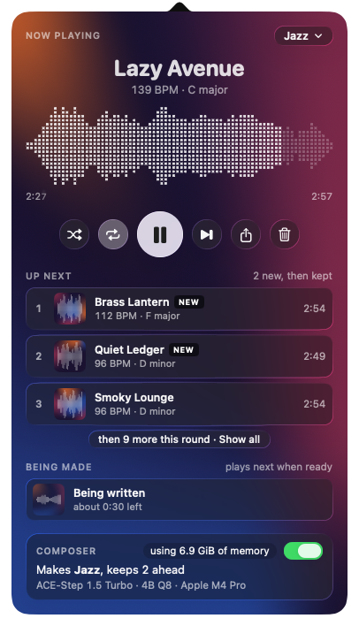
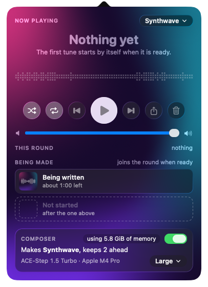
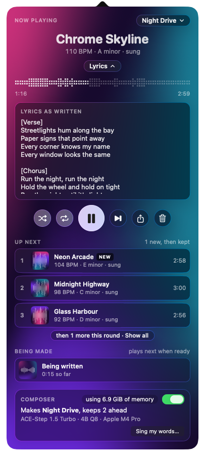
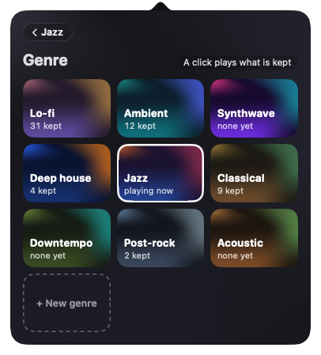
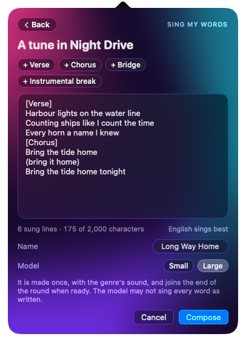
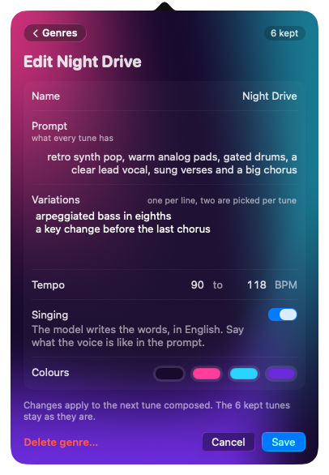
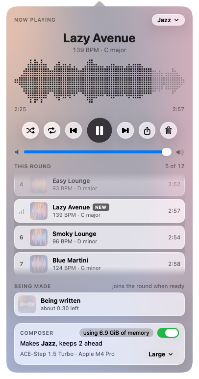

# SwiftTunes

A macOS menu bar app that plays endless music by genre, composed on your Mac
by ACE-Step 1.5 Turbo through an embedded `ace-server` running on the GPU.
Nothing is sent anywhere once the model is downloaded.

<p align="center">
  
</p>

## What it does

- **Genres you edit.** Nine genres to start with, each with its own colours.
  Add, rename or delete genres; each has a prompt, variations, a tempo range,
  four colours and a Singing switch.
- **Tunes kept, tunes made.** A genre plays the tunes kept for it. Turn the
  composer on and it writes new ones and keeps two ready ahead; a new tune
  plays next. The newest 50 of a genre are kept.
- **The queue in play order.** Up next lists what will play, numbered, new
  tunes first, then the kept ones in the round's order, shuffled or in the
  order made. Every kept tune plays once a round; repeat all, one or off.
  What is being made shows apart, under it.
- **Sung genres and your own words.** A sung genre's tunes have words,
  written by the model in English; the words of the playing tune open under
  it. From a sung genre you can also ask for one tune sung with words you
  write.
- **Scrap and undo.** Scrap the playing tune or a queued one and it can be
  brought back for ten seconds; scrapping the one being made stops it.
- **Keep for good.** A tune kept for good is never removed by the newest-50
  rule.
- **Share and drag out.** Drag a tune's picture out of the popover to drop
  the file anywhere, or use the system share sheet; copy its path, show it in
  Finder, or export a copy.
- **Rename.** Click the playing tune's name to give it another.
- **Removing the model.** The menu removes the 7.57 GiB model when you want
  the space back; your tunes stay and keep playing.
- Every tune gets a picture drawn from its name, tempo and key. Media keys
  and Now Playing work; the app can start at login.

## A look

<table>
  <tr>
    <td></td>
    <td></td>
    <td></td>
  </tr>
  <tr>
    <td></td>
    <td></td>
    <td></td>
  </tr>
</table>

## Requirements

- A Mac with Apple silicon, macOS 26 or later.
- About 8 GiB of memory free while a tune is being composed.
- 7.57 GiB of disk for the model, downloaded from Hugging Face on first use.

To build: Xcode 27 (Swift 6.4), and `cmake`. Swift 6.3 from Xcode 26.6
crashes while compiling the app's views, so Xcode 26 will not do. `cmake` is
the one tool beyond Xcode, needed only to build `ace-server`; the build uses
the Makefile generator, so nothing else. The scripts take `cmake` from
`PATH` and stop with a sentence saying so when it is missing. They install
nothing.

## Building

With Nix, enter the dev shell from `flake.nix`, which adds `cmake` and
leaves Swift, clang, the SDK and `codesign` to Xcode:

```sh
nix develop
swift build
swift test
Scripts/make-app.sh
open build/SwiftTunes.app
```

Without Nix, install `cmake` (from [cmake.org](https://cmake.org/download/)
or a package manager) so that it is on `PATH`, then run the same commands
without `nix develop`. `swift build` and `swift test` need no `cmake`.

`Scripts/make-app.sh` builds the app in release, fetches acestep.cpp at the
revision pinned in `Config/pins.json` and builds `ace-server` with Metal,
assembles `build/SwiftTunes.app`, signs it ad hoc, and checks it with
`plutil -lint` and `codesign --verify --deep --strict`.

The workflow in `.github/workflows/ci.yml` runs `swift build` and
`swift test` with Xcode 27 on a macOS runner. It exists but is switched off
for now.

## Where files live

| What | Where |
|---|---|
| Model weights, `genres.json`, `state.json` | `~/Library/Application Support/me.matteopacini.SwiftTunes/` (the models folder is excluded from backup) |
| Wave cache, scrapped tunes, work files | `~/Library/Caches/me.matteopacini.SwiftTunes/` |
| Kept tunes | `~/Music/Tunes/<genre>/` |
| Exports | `~/Music/Tunes/Exports/` |
| acestep.cpp source and build tree (building only) | `~/Library/Caches/SwiftTunes-build/`, or `$SWIFTTUNES_BUILD_CACHE` |

## Licence

SwiftTunes is licensed under the GNU General Public License, version 3 or
later; see `LICENSE`.

It bundles and downloads work by others under their own licences:

- `ace-server` is built from [acestep.cpp](https://github.com/ServeurpersoCom/acestep.cpp)
  (MIT).
- The model is [ACE-Step 1.5](https://github.com/ace-step/ACE-Step-1.5) (MIT),
  in the GGUF conversion at
  [Serveurperso/ACE-Step-1.5-GGUF](https://huggingface.co/Serveurperso/ACE-Step-1.5-GGUF).
